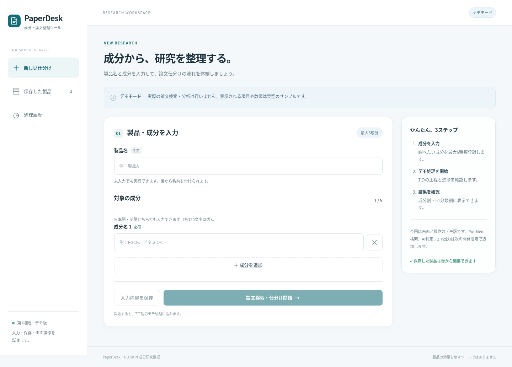

# PaperDesk — NU SKIN 学術論文整理ツール

第1段階の、実際に操作できる日本語Webアプリです。製品・最大5成分の入力、製品保存・編集・削除、サーバー側の7工程デモ、履歴、成分別・指定51分類別の結果表示を提供します。

**PubMed検索・AI判定・独立した再チェックエンジン・ZIP出力は実装していません。** 研究項目は架空のデモデータです。成分や製品の効果を示すものではありません。PubMedリンクは入力成分の検索ページで、架空のPMIDは使いません。

## 画面



[スマートフォン画面](docs/images/mobile-input.png)

## 起動

Python 3.12以上で、外部パッケージのインストールは不要です。

```sh
cd /workspace/blog/paper-tool
python server.py
```

起動したパソコンのブラウザで `http://127.0.0.1:8000` を開きます。このアドレスは外部公開URLではありません。

1. 製品名（任意）と成分名を入力。
2. 必要なら「成分を追加」で最大5種類まで追加。
3. 「入力内容を保存」で製品登録、または「論文検索・仕分け開始」でデモ処理。
4. 進捗から結果画面へ自動で移動。
5. 保存した製品や処理履歴から、再編集・再利用できます。

サーバーを動かしている間は、ブラウザを閉じても処理が続きます。サーバーが停止している間は処理は止まり、同じDBで再起動すると保存した工程から再開します。

## データ保存

- SQLite: `data/paperdesk.sqlite3`（製品、入力スナップショット、処理履歴、判定結果）。
- ブラウザのセッションストレージ: 同じタブで更新したときの未保存入力の補助復元。ブラウザ終了・保存領域の無効化後まで保証するものではありません。残したい内容は「保存」を押してください。
- 製品削除後も、実行時点の入力スナップショットと処理履歴は残ります。
- 正式な51分類は `app/taxonomy.py` に、ご指定の名称・順序のまま登録。
- `DATABASE_PATH` でDBの保存先を変更可能。
- バックアップは `python tools/backup.py`（後述）。

## テスト

```sh
python -m unittest discover -s tests -p 'test_*.py' -v
npm install --prefix /tmp/paperdesk-tests --cache /tmp/paperdesk-npm-cache playwright
NODE_PATH=/tmp/paperdesk-tests/node_modules CHROMIUM_PATH=/usr/bin/chromium node tests/browser.cjs
```

PlaywrightとChromiumはテスト時のみ必要です。Chromiumが別の場所にある場合は `CHROMIUM_PATH` で指定します。
ブラウザテストは専用の一時DBとサーバーを起動し、日常使用の製品データは変更しません。
結果と画面画像は `artifacts/` に出力します。
検証結果は [docs/TEST_REPORT.md](docs/TEST_REPORT.md) に記録します。

## 友人へのWeb公開

公開はまだ行っていません。リポジトリのルートに準備した `render.yaml` を使う場合:

1. GitHubリポジトリ `scudetto0630-dotcom/blog` を使用。ルートの `render.yaml` が `paper-tool` フォルダを指定しています。
2. RenderでそのリポジトリからBlueprintを作成。
3. 永続ディスク付きサービスを利用（有料プランが必要）。
4. Renderが生成する `APP_ACCESS_PASSWORD` を環境設定で確認。
5. RenderのHTTPS URLを開き、ユーザー名 `user` とそのパスワードでログイン。
6. 保存・再読み込み・処理完了・再起動後の保持を公開環境でも確認。

ディスクを使わない構成では再デプロイでDBを失う可能性があります。無料の一時ファイル領域を保存先にしないでください。
自動生成パスワードはチャット・リポジトリに掲載しません。複数人で利用する場合、現段階では共有ワークスペースです。ユーザー別のログイン・権限・データ分離は次の段階です。

## 開発構成

- `server.py`: HTTP/API、入力・アクセス検査、デモワーカーの起動。
- `app/models.py`: 入力検証と工程定義。
- `app/store.py`: SQLiteデータ管理。
- `app/worker.py`: サーバー側デモ処理、工程の保存と再開。
- `app/demo.py`: 科学的判断を伴わない固定の架空データ。
- `app/taxonomy.py`: ご指定の51分類。
- `app/static/`: 日本語UI（HTML/CSS/JavaScript）。
- `tests/`: バックエンド・実ブラウザテスト。

既存のブログ・WordPressプラグイン・編集キーは利用せず、変更していません。
将来のPubMed、AI、教師データ、2回の独立検証との接続設計は [docs/ARCHITECTURE.md](docs/ARCHITECTURE.md) にまとめています。
